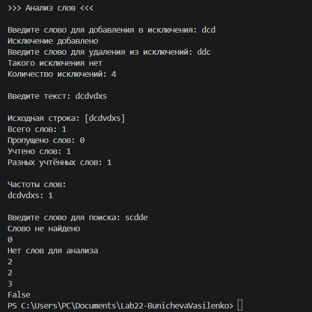

# Практическая работа №22

Авторы: Буничева Дарья и Василенко Полина  
Группа: ИСП-252

Короткие ответы

Что должно быть уникальным в Dictionary и в HashSet?

в Dictionary уникальны ключи, значения могут повторяться; в HashSet уникален каждый элемент.

Чем отличается повторное добавление в HashSet от Dictionary.Add() с существующим ключом?

HashSet.Add() при дубликате возвращает false и ничего не меняет, а Dictionary.Add() с существующим ключом выбрасывает исключение.

Почему для поиска по неизвестному ключу удобно использовать TryGetValue()?

TryGetValue() не выбрасывает исключение при отсутствии ключа: возвращает false и сразу позволяет проверить наличие и получить значение.

Результат
